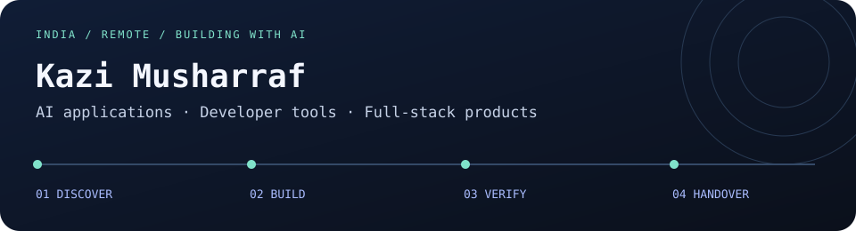

# Kazi Musharraf

**[Explore my work](https://devtools.mkazi.live/explore) · [Inspect case studies](https://devtools.mkazi.live/case-studies) · [Discuss a role](https://devtools.mkazi.live/hire) · [Scope a project](https://devtools.mkazi.live/consulting)**

AI Engineer & Full-Stack Developer based in India. Also known as Musharraf Ateeque Kazi, Musharraf Kazi and MK Knight.

I build AI agents, LLM applications, developer tools and web products using TypeScript, Python, React, Next.js, Node.js and PostgreSQL. I use Codex, Claude Code and Cursor alongside software engineering practices.

Open to **remote AI Engineer roles**, international client projects and consulting discussions in **USD or AED**. Share your problem, stack, expected deliverables, timeline and budget.

- [Email](mailto:kazimusharraf1234@gmail.com)
- [AI engineering portfolio](https://devtools.mkazi.live/)
- [Professional biography](https://devtools.mkazi.live/about)
- [Consulting](https://devtools.mkazi.live/consulting)
- [LinkedIn](https://www.linkedin.com/in/kazi-musharraf-0674871a4)

## Professional background

Project Engineer, Wipro Technologies, July 2022–July 2025. Previously Project Intern, February–July 2022. Enterprise application experience in banking and fintech, including Citibank ICG and HSBC client assignments.

B.Tech in Computer Science & Engineering, M.S. Bidve Engineering College, Latur, 2018–2022.

## Selected work

| Project | What to review |
| --- | --- |
| [MK QuizFlow](https://github.com/mk-knight23/MK-QuizFlow) | Browser-based study app; [live site](https://www.thequizflow.com/) |
| [AI assistant workflows](https://github.com/mk-knight23/AI-ASSISTANTS-ECOSYSTEM) | Coding agent configurations, skills and workflow documentation |
| [OpenCode showcase](https://github.com/mk-knight23/AI-ASSISTANT-OPENCODE) | Agent instructions and workflow examples |
| [AI SDK Anthropic](https://github.com/mk-knight23/AI-SDK-ANTHROPIC) | Python agent routing and SDK adapter experiments; see README for current limits |
| [Portfolio time router](https://github.com/mk-knight23/mkazi-time-router) | Portfolio routing, profile endpoints and tests |

## Explore with an AI assistant

My portfolio exposes four read-only tools: public profile, project search, project detail and an unsent discussion brief. Results link to original evidence and explain implementation limits.

- [Agent connection guide](https://mkazi.live/agents)
- Remote MCP endpoint: `https://mkazi.live/mcp`
- [Public catalog](https://mkazi.live/api/portfolio) · [Markdown profile](https://mkazi.live/portfolio.md) · [OpenAPI](https://mkazi.live/openapi.json)

A compatible MCP client can retrieve these public facts. Connecting tools does not guarantee recommendations or search ranking. Briefs remain drafts; nothing is sent or agreed automatically.

## Portfolio network

[AI engineering](https://devtools.mkazi.live/) · [Full-stack](https://fullstack.mkazi.live/) · [Frontend](https://frontend.mkazi.live/) · [Backend](https://backend.mkazi.live/) · [AI interfaces](https://ai.mkazi.live/)

Repository examples demonstrate implementation choices; they are not claims of client adoption, revenue or measured business outcomes.

## Skills & engineering approach

- **Application engineering:** TypeScript, JavaScript, Python, Java, SQL; React, Next.js and Node.js.
- **AI applications:** model API integration, Vercel AI SDK, structured generation, prompt design and explicit fallback states, demonstrated in QuizFlow.
- **Developer workflows:** agent instructions, reusable skills and AI-assisted coding with Codex, Claude Code, Cursor and OpenCode.
- **Python experiments:** FastAPI contracts, mission routing, CLI runners, LangChain prompt composition and Anthropic client initialization. See each README for implementation limits.
- **Delivery:** Git, GitHub Actions, tests, Vercel and Cloudflare. My broader web stack includes PostgreSQL, Supabase and Prisma.

[Skills with source evidence](https://devtools.mkazi.live/skills) · [Engineering case studies](https://devtools.mkazi.live/case-studies)

## Work with me

I’m seeking **AI Engineer, Applied AI Engineer, Full-Stack AI Engineer and Developer Tools Engineer** roles that accept India-based applicants. I welcome US, UK and UAE teams that can engage engineers remotely from India.

I also take on scoped **freelance development and consulting**: AI feature integration, React/Next.js applications, APIs, developer workflow setup and technical discovery. USD and AED project discussions are welcome. Availability, working-hour overlap, confidentiality and any parallel commitments are agreed before starting.

[Discuss a remote role](https://devtools.mkazi.live/hire) · [Discuss a client project](https://devtools.mkazi.live/consulting) · [Email your brief](mailto:kazimusharraf1234@gmail.com)

## AI-native tools and implementation direction

My workflow includes **Claude Code, OpenAI Codex, Cursor, ChatGPT, Claude and Gemini**, combined with code review, tests and deployment checks. Public workflow repositories cover OpenCode, GitHub Copilot and related assistants. SDK/framework experiments are labelled separately from shipped product features.

I’m also exploring **remote Forward Deployed AI Engineer and AI Consultant** opportunities: understand the workflow, scope a useful outcome, build a demonstrable version, verify behavior and document handover. This describes a delivery direction, not a previous formal FDE job title.

Previous independent work includes US client engagements. I welcome remote collaboration with US, UK, UAE and Indian teams from my India base. City coverage describes offered remote service markets, not overseas offices or work authorization.

[AI toolkit](https://devtools.mkazi.live/ai-tools) · [Forward-deployed approach](https://devtools.mkazi.live/forward-deployed-engineer) · [AI consulting](https://devtools.mkazi.live/ai-consultant) · [Global collaboration](https://devtools.mkazi.live/global-collaboration) · [FAQ](https://devtools.mkazi.live/faq)

## Public project pulse

<!-- PROJECT-SNAPSHOT:START -->
Public repository snapshot · checked 2026-10-19 UTC.

| Repository | Main language | Stars | Last pushed (UTC) |
| --- | --- | ---: | --- |
| [MK-QuizFlow](https://github.com/mk-knight23/MK-QuizFlow) | TypeScript | 8 | 2026-07-27 |
| [AI-ASSISTANTS-ECOSYSTEM](https://github.com/mk-knight23/AI-ASSISTANTS-ECOSYSTEM) | HTML | 0 | 2026-10-19 |
| [AI-ASSISTANT-OPENCODE](https://github.com/mk-knight23/AI-ASSISTANT-OPENCODE) | HTML | 0 | 2026-10-19 |
| [AI-SDK-ANTHROPIC](https://github.com/mk-knight23/AI-SDK-ANTHROPIC) | Python | 0 | 2026-05-07 |
| [mkazi-time-router](https://github.com/mk-knight23/mkazi-time-router) | TypeScript | 0 | 2026-10-19 |

Repository metadata is a dated snapshot, not a measure of engineering quality, employment or client adoption.
<!-- PROJECT-SNAPSHOT:END -->

How this profile updates, and where the design ideas came from

The weekly workflow reads metadata for five selected public repositories and updates only the marked block and a local JSON snapshot. A failed request preserves the previous evidence. The banner is an original SVG served from this repository; its animation respects reduced motion.

Inspired by [Simon Willison’s self-updating profile](https://github.com/simonw/simonw), [DenverCoder1’s project grouping](https://github.com/DenverCoder1/DenverCoder1), and the [Awesome GitHub Profile README directory](https://github.com/abhisheknaiidu/awesome-github-profile-readme). See the [repository-by-repository review](docs/profile-reference-review.md).

